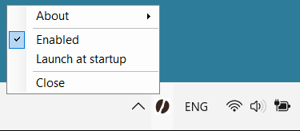

# CoffeeBean
<br>
A utility to prevent a policy-enforced screen lock in Windows.<br>
Windows can be configured to lock the screen after some time of inactivity.<br>
If corporate IT policies enforce this option, it is impossible to disable it via Windows settings.<br>
This utility is a convenient and reliable way to solve this problem.

## System requirements
* Windows 7 or higher

## How to install

### Option 1: Install via Winget
```
winget install -e --id PolarGoose.CoffeeBean
```

### Option 2: Use portable executable
Download `CoffeeBean.zip` (portable executable) from the latest [release](https://github.com/PolarGoose/CoffeeBean/releases)

## How to use
* Start the application, and you will get an icon in the system tray
* As you keep this tool running, it prevents the screen from auto-locking
* You can still lock the screen manually, if you want, by using Windows default methods/shortcuts (for example, by pressing `Win+L`)
* To close the utility, click `Close` in the tray icon context menu. After the utility is closed, the locking behavior returns to what it was before you started the utility
* Use the `Launch at startup` context menu item if you want the application to run at Windows startup.
* Left-click the tray icon or use the `Enabled` context menu item to turn the screen lock prevention functionality on or off.

### Running the application from console
Command-line arguments control screen lock functionality. You can use them in the following way:
* Launch the application with screen lock prevention functionality enabled or enable the screen lock prevention functionality of an already running instance of the application:
```
CoffeeBean.exe enable
```
* Launch the application with screen lock prevention functionality disabled or turn off screen lock functionality of an already running instance of the application:
```
CoffeeBean.exe disable
```

## How it works
The application uses the [SetThreadExecutionState](https://docs.microsoft.com/en-us/windows/win32/api/winbase/nf-winbase-setthreadexecutionstate) WinAPI method, which allows an application to keep the system "in use" even if there is no user activity. It is better than simulating key presses or mouse movements. For instance, video players use it to keep the screen on while playing a video.

## How to build
* Use `Visual Studio 2026` to work with the code.
* Run `build.ps1` to build a release (`git.exe` should be in your PATH)
